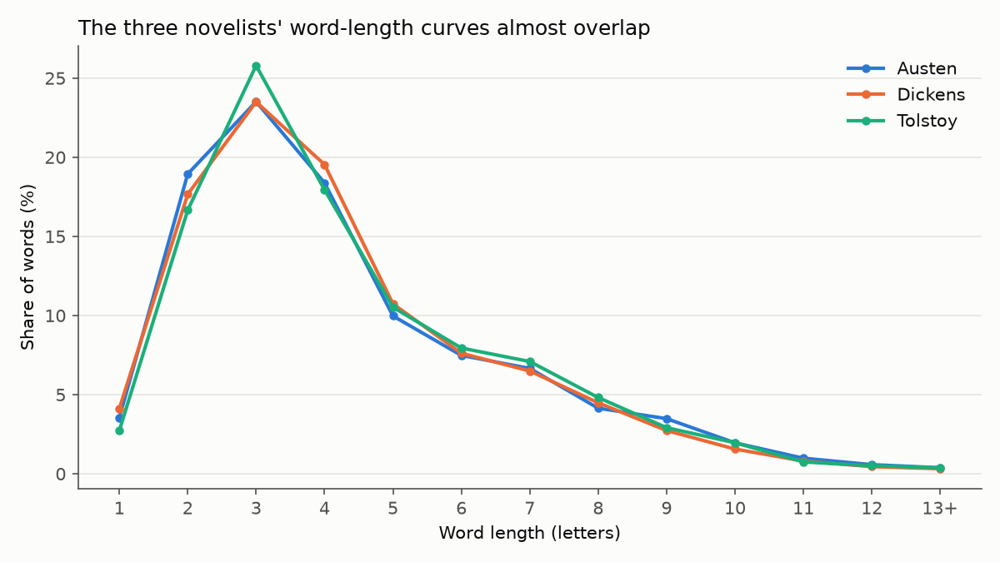
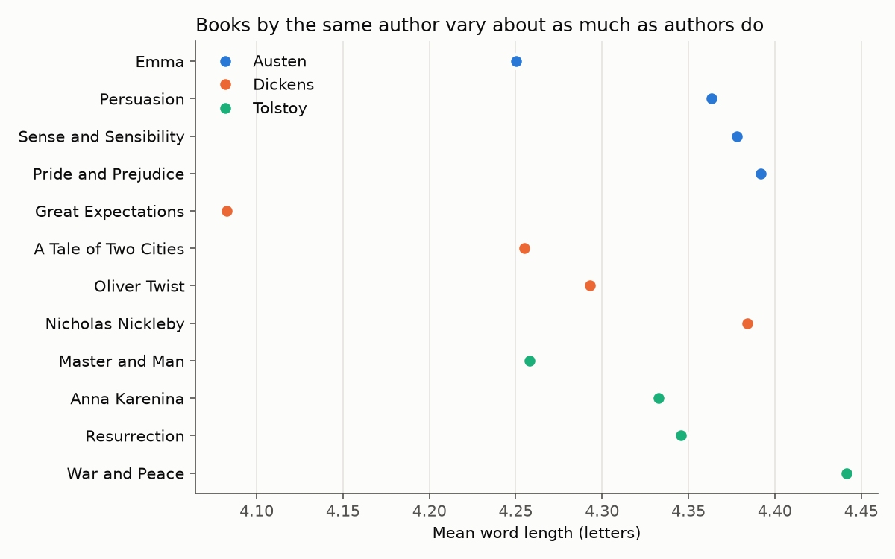

# Methods and full results

Every number here is produced by `uv run python -m wld.analysis` and saved in
[`results/`](results/). Accuracy always means **balanced accuracy**: the mean of per-author
recall, so the chance level is 1 / (number of authors).

## 1. Data

| Set | Texts | Words | Use |
|---|---|---:|---|
| Novels | Austen, Dickens, Tolstoy: 4 novels each ([`results/books.csv`](results/books.csv)) | 2,401,328 | Main comparison |
| Federalist Papers | 51 Hamilton, 14 Madison, 12 disputed (plus 5 Jay, 3 joint, unused) | 174,126 (H + M + disputed) | Real-world test |
| Translations | Dostoevsky: 3 translated by Garnett, 1 by Eva Martin | | Translator check |

**Cleaning.** [`data/books.csv`](data/books.csv) records the first and last phrase of each
novel's narrative. The code keeps the text between them, which drops editors' prefaces (e.g.
Saintsbury's 1894 preface to *Pride and Prejudice*), contents pages and Gutenberg licenses.
It also removes illustration captions and chapter headings. Federalist papers keep the text
from "To the People of the State of New York" to the "PUBLIUS" signature, which drops titles,
datelines and footnotes. Authorship follows Mosteller & Wallace; the source file's own
labels are ignored because it credits the disputed papers to Madison.

**Tokens.** A word is a run of letters (internal apostrophes allowed), lowercased. A word's
length is its letter count.

**Translators.** *Anna Karenina* is Garnett's translation. *Resurrection* and *Master and
Man* are the Maudes'. The *War and Peace* file names no translator; its text matches the
Maude translation. It is labeled "Maude (inferred)" and left out of the translator check.

## 2. Features and model

- **Word length:** share of words with 1, 2, …, 12, and 13+ letters (13 features).
- **Function words:** rate of each of the 70 words used by Mosteller & Wallace (1964),
  e.g. *a, by, upon, would*. They are topic-neutral, so they track habit rather than subject.
- **Model:** standardized multinomial logistic regression, classes weighted equally
  (`sklearn`, default L2 penalty). It is the same model for every comparison.

## 3. Novels: which signal identifies the author?

Leave-one-book-out: each book is cut into consecutive passages of *n* words. A model trained
on passages from the other 11 books predicts the held-out book's passages. No passage of a
test book is ever in training, so the model can't win by memorizing a book's characters or
setting. ([`results/accuracy_by_passage_length.csv`](results/accuracy_by_passage_length.csv))

| Passage length (words) | 100 | 250 | 500 | 1,000 | 2,500 | 5,000 |
|---|---:|---:|---:|---:|---:|---:|
| Function words | 64% | 77% | 85% | 90% | 97% | 99% |
| Word length | 42% | 44% | 47% | 50% | 57% | 62% |
| Books correct by majority vote (function words / word length) | 12 / 9 | 12 / 11 | 12 / 10 | 12 / 10 | 12 / 10 | 12 / 10 |

At 1,000 words, the word-length model's majority vote misassigns *Great Expectations*
(to Austen) and *War and Peace* (to Dickens). The function-word model's weakest book is
*A Tale of Two Cities*, with 73% of its passages correct.
([`results/per_book_1000_words.csv`](results/per_book_1000_words.csv))

## 4. Word length in detail: significant, but small

**Distributions.** The three novelists' curves nearly overlap
([`results/word_length_distributions.csv`](results/word_length_distributions.csv)).

**Chi-square tests of homogeneity, with effect size.** With millions of words, any
difference is "significant", so Cramér's V (0 = identical distributions) is the number to
read. ([`results/chi_square_tests.csv`](results/chi_square_tests.csv))

| Comparison | Words | χ² (df) | p | Cramér's V |
|---|---:|---:|---:|---:|
| Between the three authors | 2,401,328 | 8,055 (24) | < 10⁻³⁰⁰ | 0.041 |
| Among Austen's books | 486,467 | 878 (36) | 5 × 10⁻¹⁶¹ | 0.025 |
| Among Dickens's books | 805,873 | 3,942 (36) | < 10⁻³⁰⁰ | 0.040 |
| Among Tolstoy's books | 1,108,988 | 3,404 (36) | < 10⁻³⁰⁰ | 0.032 |

The difference between authors (V = 0.041) is no bigger than the difference among Dickens's
own novels (V = 0.040). The smallest expected cell count is 73, so the test's assumptions
hold.

**Is the author effect real at all?** The chi-square test treats words as independent, but
words within a book are not. With the **book** as the unit, an exact permutation test
compares the author grouping's PERMANOVA pseudo-F (Hellinger-transformed word-length
profiles) with all 34,650 relabelings of the 12 books into groups of four. The true grouping
is the most separated: pseudo-F = 4.04, p = 6/34,650 ≈ 0.00017, the smallest p this design
allows. A small, real signal.

**Is 50% accuracy better than chance?** Passages from the same book are correlated, so a
binomial test would overstate the evidence. Instead, author labels were shuffled between
whole books 200 times and the word-length model was re-evaluated each time. Shuffled
accuracy: median 31%, 95th percentile 43%. The observed 50% gives p ≈ 0.01
([`results/summary.json`](results/summary.json)).

## 5. Federalist Papers

**Validation** (leave one known paper out;
[`results/federalist_validation.csv`](results/federalist_validation.csv),
[`results/federalist_validation_papers.csv`](results/federalist_validation_papers.csv)):

| Features | Balanced accuracy | Correct |
|---|---:|---:|
| Function words | 99% | 64 / 65 (missed No. 13: P(Madison) = 0.52) |
| Word length | 65% | 48 / 65 |

No. 13 is the shortest paper in the collection (960 words).

**Disputed papers** (model trained on all 65 known papers;
[`results/federalist_disputed.csv`](results/federalist_disputed.csv)):

| Paper | 49 | 50 | 51 | 52 | 53 | 54 | 55 | 56 | 57 | 58 | 62 | 63 |
|---|---|---|---|---|---|---|---|---|---|---|---|---|
| P(Madison), function words | .95 | .98 | 1.00 | .97 | 1.00 | .94 | **.41** | .94 | .98 | .93 | .97 | .98 |
| P(Madison), word length | .57 | .91 | .61 | .28 | .64 | .03 | .12 | .79 | .18 | .52 | .36 | .72 |

**Marker words**, per 1,000 words
([`results/federalist_marker_words.csv`](results/federalist_marker_words.csv)):

| | upon | whilst | while | enough | there |
|---|---:|---:|---:|---:|---:|
| Hamilton (51 papers) | 3.34 | 0.01 | 0.32 | 0.30 | 3.41 |
| Madison (14) | 0.18 | 0.31 | 0.00 | 0.00 | 0.85 |
| Disputed (12) | 0.13 | 0.37 | 0.00 | 0.00 | 1.33 |

On every marker the disputed papers look like Madison.

## 6. Translator check

The Tolstoy novels are translations, so "Tolstoy" partly means "his translator." To probe
this, a model was trained on Tolstoy translated by the Maudes (*Resurrection*, *Master and
Man*) against Dostoevsky translated by Garnett (*Crime and Punishment*, *The Brothers
Karamazov*, *The Possessed*). It was then tested on the crossed cases, using 1,000-word
passages ([`results/translator_check.csv`](results/translator_check.csv)):

| Test book | Translator | Passages assigned to Dostoevsky (function words / word length) |
|---|---|---:|
| *Anna Karenina* (Tolstoy) | Garnett | 71% / 68% |
| *The Idiot* (Dostoevsky) | Eva Martin | 87% / 86% |

*Anna Karenina* follows its translator, while *The Idiot* follows its author. The signal
is a mix of the two, and the design is too small (two training books for Tolstoy) to say
how much of each. This is why translation is listed as a limitation rather than corrected
for.

## 7. Limitations

- **Few authors.** Three candidates for the novels and two for the Federalist Papers.
  Attribution among many candidates is harder.
- **Translation** (section 6).
- **Era and genre** are roughly held constant (18th–19th-century English prose).
- **Probabilities are not calibrated.** Logistic regression on 65 papers can be
  overconfident, so read Federalist probabilities as rankings of confidence, not exact odds.
