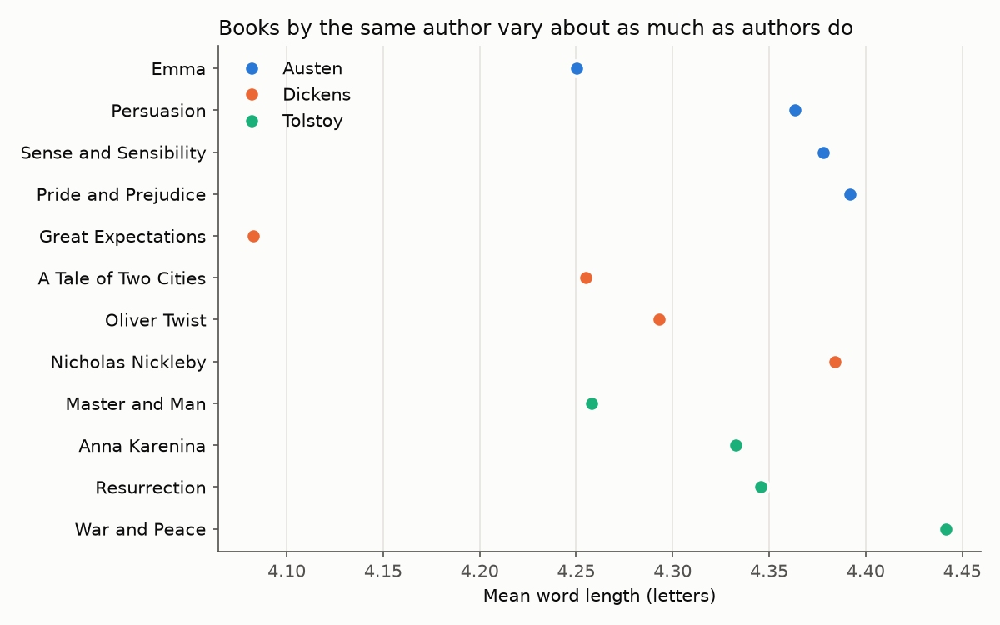
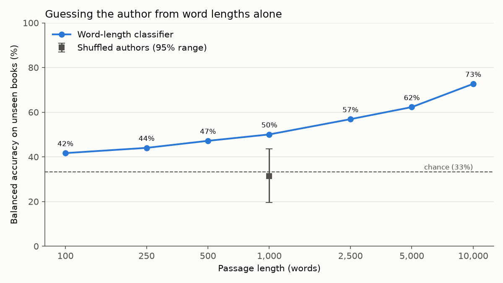

# Do authors have a word-length fingerprint?

[](https://github.com/4mnestic/word-length-distribution-goodness-of-fit/actions/workflows/ci.yml)

In 1887 the physicist T. C. Mendenhall suggested that every writer has a characteristic
"curve" of word lengths: how often they use 1-letter words, 2-letter words, and so on.
He believed the curve could be used to identify who wrote a text. He compared the
curves by eye but never tested the idea statistically.

This project tests it on **12 novels by Jane Austen, Charles Dickens and Leo Tolstoy**
(2.4 million words in total).

## The short answer

- **Authors do differ, but only slightly.** Their word-length curves almost overlap, and
  the differences between authors are about as large as the differences between two books
  by the same author.
- **The differences are real, not noise.** Of the 5,775 possible ways to split the
  12 books into three groups of four, grouping them by their real author separates
  them best (p ≈ 0.0002).
- **They are too weak to be a fingerprint.** Shown a 1,000-word passage from a book it has
  never seen, a model that knows only word lengths names the right author 50% of the time.
  Random guessing would score 33%. With 10,000 words it reaches 73%. Mendenhall's signal
  exists, but it is not a reliable way to identify a writer.

## The data

Twelve public-domain novels from Project Gutenberg, four per author
([`data/books.csv`](data/books.csv)). For each book the code keeps only the story
itself, using a start and end phrase recorded in that file. It removes the editor's
prefaces, contents pages, illustration captions and chapter headings. A **word** is a run
of letters, and its length is its number of letters. Punctuation and numbers don't count,
and apostrophes don't add to the length (*don't* has 4 letters).

> **Caveat:** Tolstoy wrote in Russian. These are English translations by Constance Garnett
> (*Anna Karenina*) and Louise and Aylmer Maude (the other three). The *War and Peace* file
> doesn't name its translator; its text matches the Maude translation. So the
> "Tolstoy" results describe his translators' English as much as Tolstoy himself.

## Results

### 1. The curves nearly overlap


All three authors use 3-letter words most often (*the, and, was*). The visible differences
are small. The Tolstoy translations use slightly more 3-letter words (25.8% vs. 23.5%) and
fewer 1-letter words (2.7% vs. 3.5–4.1%). Austen uses slightly more 2-letter and 9-letter
words. ([`results/author_distributions.csv`](results/author_distributions.csv))

### 2. "Statistically significant" is not the same as "large"

A chi-square test asks whether groups share the same distribution. With millions of words,
it flags even tiny differences, so every comparison below is overwhelmingly "significant."
The useful number is **Cramér's V**, which measures how big the difference is on a 0–1
scale (0 means identical distributions).

| Comparison | Words | Chi-square (df) | p | Cramér's V |
|---|---:|---:|---:|---:|
| Between the three authors | 2,401,328 | 8,055 (24) | < 10⁻³⁰⁰ | **0.041** |
| Among Austen's four books | 486,467 | 878 (36) | 5 × 10⁻¹⁶¹ | 0.025 |
| Among Dickens's four books | 805,873 | 3,942 (36) | < 10⁻³⁰⁰ | 0.040 |
| Among Tolstoy's four books | 1,108,988 | 3,404 (36) | < 10⁻³⁰⁰ | 0.032 |

([`results/chi_square_tests.csv`](results/chi_square_tests.csv). Every expected cell count
is at least 73, so the test's assumptions hold.)

The difference *between* authors (V = 0.041) is about the same as the difference among
Dickens's own novels (V = 0.040). The chart below shows the same thing with a simpler
number, each book's average word length:



*Great Expectations* (4.08 letters) and *Nicholas Nickleby* (4.38) are both Dickens, yet
they are further apart than most books by different authors.
([`results/books.csv`](results/books.csv))

### 3. But the author signal is real

The chi-square test treats every word as an independent observation. Words aren't
independent: a book's subject, narrator and era affect all of its words together. So the
fair unit of evidence is the **book**, and with 12 books the evidence is limited.

An **exact permutation test** respects that. It measures how well the author grouping
separates the books' word-length profiles (a PERMANOVA pseudo-F on Hellinger-transformed
proportions). It then compares that against **every** other way of splitting the 12 books
into three groups of four, all 34,650 labelings. The real grouping is the most separated
of them all: pseudo-F = 4.04, p = 6/34,650 ≈ 0.00017, the smallest p-value this test can
produce. ([`results/summary.json`](results/summary.json))

### 4. Can word lengths identify the author of a new passage?

This is the question Mendenhall actually cared about. Each book is cut into passages of
equal length, and each passage is described by its 13 word-length proportions. A logistic
regression is trained on 11 books and tested on the 12th, rotating through all 12. The
model is never tested on a book it saw during training, so it can't succeed by recognizing
a familiar book.



| Passage length | 100 | 250 | 500 | 1,000 | 2,500 | 5,000 | 10,000 |
|---|---:|---:|---:|---:|---:|---:|---:|
| Balanced accuracy | 42% | 44% | 47% | 50% | 57% | 62% | 73% |

([`results/classification_by_chunk_size.csv`](results/classification_by_chunk_size.csv))

Is 50% really better than chance? To check, the author labels were shuffled between whole
books 200 times and the model was retrained on each shuffle. On shuffled labels it scored a
median of 31%, and 95% of runs scored at most 43%. The real 50% beat all but one shuffle
(p ≈ 0.01), so the signal is genuine, just weak.

When each held-out book is labeled by a majority vote of its 1,000-word passages, 10 of 12
books get the right author. The two misses are *Great Expectations* (labeled Austen) and
*War and Peace* (labeled Dickens).
([`results/classification_per_book_1000.csv`](results/classification_per_book_1000.csv),
[`results/confusion_matrix_1000.csv`](results/confusion_matrix_1000.csv))

## Limitations

- **Three authors, twelve books.** Book-level conclusions rest on 12 data points.
- **Translation.** The "Tolstoy" books measure Garnett's and the Maudes' English (see above).
- **Genre and era are mixed in with author.** All three are 19th-century novelists, but
  differences in subject matter (Tolstoy's war scenes, Dickens's dialect) can drive word
  length as much as personal style.
- **Word length is a single, coarse feature.** Modern authorship attribution relies on
  function-word frequencies and character n-grams, which carry far more signal.

## What changed from the 2024 version

This started as a 2024 term project ([original paper and code](archive/2024/)). On review,
its conclusions did not hold up:

| 2024 issue | Effect | Fix |
|---|---|---|
| Word-length bins were in first-seen order (`[wld.get(k) for k in wld.keys()]`), so Austen's first bin was 11-letter words while Dickens's was 7-letter words | The chi-square compared counts of *different* word lengths, inflating chi-square to 245,000–685,000 (rerun and paper) | Bins indexed by length, with a regression test (`tests/test_corpus.py`) |
| Punctuation tokens were counted as 1-letter words (19–22% of all "words") | The length-1 bin was mostly commas and periods | Letters-only tokenizer |
| Prefaces left in place (e.g. George Saintsbury's 1894 preface to *Pride and Prejudice*, Dickens's preface to *Nickleby*) | Non-author text counted as the author's | Start/end markers in the manifest, applied in code |
| Each author was tested against a pooled average that included themselves, using a goodness-of-fit test | Wrong degrees of freedom; not a test of whether groups differ | Chi-square test of homogeneity on the full table |
| "p = 0.0, so authors differ" | With millions of words, significance is guaranteed and says nothing about size | Effect sizes, a book-level permutation test, and an out-of-sample classifier |
| Results depended on `os.listdir` order, and plots blocked the script | Not reproducible: rerunning the 2024 code does not give the paper's numbers | Deterministic pipeline, one command, saved outputs |

The 2024 conclusion was that authors couldn't be distinguished because "even books by the
same author come from different distributions." The corrected analysis finds a small but
real author signal that becomes useful only with long passages.

## Reproduce it

Requires [uv](https://docs.astral.sh/uv/) (it installs Python and the locked dependencies).

```bash
uv sync
uv run python -m wld.analysis   # ~1 minute; writes results/ and figures/
uv run pytest                   # unit tests with coverage report
```

Everything is deterministic (fixed random seed), so the outputs should match the committed
files exactly.

## Repository layout

```
data/books.csv          manifest: author, translator, start/end markers per book
data/texts/             the 12 Project Gutenberg texts
wld/corpus.py           cleaning, tokenizing, word-length bins
wld/stats.py            chi-square + Cramér's V, exact permutation test
wld/classify.py         passage features, leave-one-book-out classifier
wld/analysis.py         runs everything, writes results/ and figures/
tests/                  unit and end-to-end tests (100% line coverage)
archive/2024/           original term paper and code, kept for reference
```

## Reference

Mendenhall, T. C. (1887). The characteristic curves of composition. *Science*, 9(214),
237–249. <https://www.jstor.org/stable/1764604>
