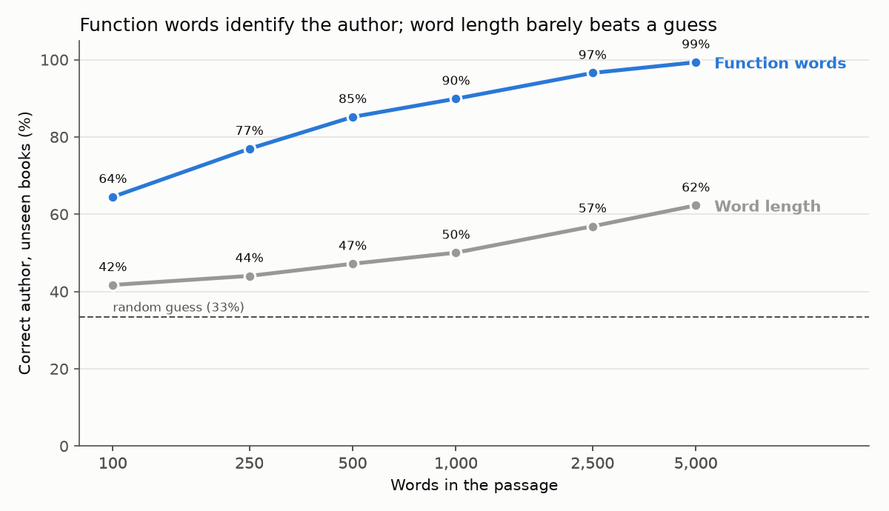
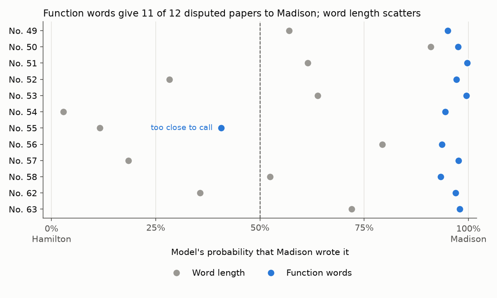

# Who wrote it? Identifying authors from their writing habits

[](https://github.com/4mnestic/word-length-distribution-goodness-of-fit/actions/workflows/ci.yml)

In 1887, T. C. Mendenhall claimed every writer has a telltale pattern of word lengths. I tested
that on 2.4 million words from Austen, Dickens and Tolstoy, found a signal that works far
better, and used it on the disputed Federalist Papers.

## Results

- **Word length doesn't identify authors.** On 1,000-word passages it picks the right author
  50% of the time, against 33% for a random guess. A [chi-square test](wld/stats.py#L9)
  (SciPy) calls the differences between authors significant, but the effect size (Cramér's
  V = 0.04) is [no bigger](METHODS.md#word-length-significant-but-tiny) than the
  differences among one author's own books. With millions of words, "significant" doesn't
  mean "useful."
- **Function words do.** I [engineered features](wld/features.py#L48) from how often a
  writer uses 70 common words (*the, upon, would, whilst*…) and fed them to a scikit-learn
  [logistic regression](wld/classify.py#L15). Accuracy is 90% at 1,000 words and 99% at
  5,000. All 12 novels are attributed correctly.
- **The Federalist Papers.** After correctly attributing 64 of 65 papers of known authorship,
  the model [assigns probabilities](wld/classify.py#L87) to the 12 disputed papers: 11 go to
  Madison with at least 93% confidence, matching the historical consensus. No. 55 is too
  close to call.



## The Federalist Papers

Hamilton and Madison both claimed authorship of 12 of these 1787–88 essays. Their word
lengths are nearly identical, so word length can't separate them (grey). Function words can
(blue):



The clearest single clue is *upon*. Hamilton uses it 3.3 times per 1,000 words, Madison
0.18 times, and the disputed papers 0.13 times.

## How it was tested

- **No data leakage.** Every score comes from text the model never saw. For the novels,
  I [train on 11 books and test on the 12th](wld/classify.py#L26), rotating through all 12;
  for the Federalist Papers, I [hold out one paper at a time](wld/classify.py#L66).
  Splitting randomly would let the model recognize a book's characters instead of its
  author's style.
- **Class imbalance handled.** Hamilton wrote 51 of the 65 known papers, so always guessing
  "Hamilton" would be right 78% of the time. Classes are weighted equally and scored with
  [balanced accuracy](wld/classify.py#L53), which that trick can't fool.
- **Cleaning done in code, not by hand.** A [manifest](data/books.csv) records where each
  narrative starts and ends; [`clean`](wld/corpus.py#L47) removes editors' prefaces,
  illustration captions and chapter headings with regular expressions, and NumPy turns the
  text into features.

Full tables are in [METHODS.md](METHODS.md).

## Limitations

- Only three novelists, and a two-way choice for the Federalist Papers. Choosing among many
  authors is harder.
- The Tolstoy novels are English translations, so their "author" signal partly reflects the
  translators.

## Reproduce

One command rebuilds every table (pandas) and chart (matplotlib) from the raw texts.
Dependencies are locked with uv, and the [pytest suite](tests/) runs on every push via
GitHub Actions.

```bash
uv sync
uv run python -m wld.analysis   # rewrites results/ and figures/
uv run pytest
```

## Background

This project began as a term paper for LING 388, which I later extended with
[Claude](https://claude.ai).

## References

- Mendenhall, T. C. (1887). The characteristic curves of composition. *Science*, 9(214), 237–249.
- Mosteller, F., & Wallace, D. L. (1964). *Inference and Disputed Authorship: The Federalist*.
  Addison-Wesley.
