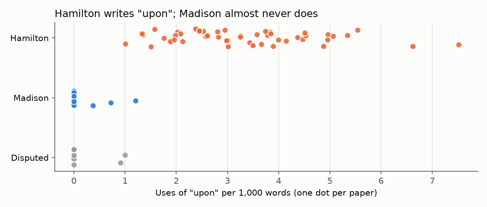

# Who wrote it? Identifying authors from their writing habits

[](https://github.com/4mnestic/word-length-distribution-goodness-of-fit/actions/workflows/ci.yml)

In 1887, T. C. Mendenhall proposed that every writer has a telltale pattern of word lengths
that could reveal who wrote a text. I tested that idea on 2.4 million words of fiction,
found a signal that works far better, and applied it to the best-known authorship dispute
in American history.

## Highlights

- **Showed the 1887 idea doesn't hold up.** From a 1,000-word passage, word length names the
  right author only **50%** of the time, against 33% for a random guess.
- **Found a signal that does work: 90% accuracy** on the same passages, using how often a
  writer uses 70 common "function words" (*the, upon, would, whilst*…). It reaches **99%** at
  5,000 words and attributes all 12 novels correctly. Every score comes from books the
  model never saw during training.
- **Settled a real dispute.** Hamilton and Madison both claimed 12 of the Federalist Papers.
  The model, first validated on 64 of 65 papers of known authorship, assigns **11 of the 12
  to Madison with at least 93% confidence**, matching the historical consensus. It flags the
  twelfth, No. 55, as too close to call.
- **Avoided the traps that make results look better than they are:** no test book is ever
  seen in training, effect sizes are reported alongside p-values, results are checked against
  shuffled labels, and a confounder (the translator) is tested directly.


## Recommendation

If you need to attribute an unsigned text:

1. **Use function-word frequencies, not word length.** Word length barely beats a guess
   (see chart above).
2. **Set a minimum input length.** Expect about 85% accuracy at 500 words, 90% at 1,000 and
   97% at 2,500. Below about 500 words, treat the result as a hint.
3. **Report a probability, not just a name, and send close calls to a human.** The model's
   only miss on known Federalist papers was the shortest one (No. 13, 960 words), and it was
   a near coin-flip (52% vs. 48%).
4. **Check who else touched the text.** For translated novels the translator leaves a
   fingerprint too (see [limitations](#limitations)).

## The Federalist Papers

In 1787–88 Hamilton, Madison and Jay published 85 essays under one pen name. Twelve were later
claimed by both Hamilton and Madison. Their word lengths are nearly identical, so the 1887
method can't separate them: it gets 65% on known papers, and its verdicts on the disputed
papers scatter (grey dots). Function words separate them cleanly (blue dots):


The clearest single clue is the word *upon*. Hamilton uses it 3.3 times per 1,000 words.
Madison uses it 0.18 times, and the disputed papers 0.13 times.



No. 55 was also among the weakest cases in Mosteller and Wallace's landmark 1964 study of
these papers.

## How it works

- **Data:** 12 novels by Austen, Dickens and Tolstoy (4 each), all 85 Federalist Papers, and
  4 Dostoevsky novels for a translator check. All are public domain, from Project Gutenberg.
  Prefaces, contents pages and chapter headings are stripped in code.
- **Features:** each passage becomes a short list of rates: either the share of words of
  each length, or how often each of the 70 function words appears.
- **Model:** logistic regression. It is deliberately simple, so the comparison is about the
  signal rather than the model.
- **Evaluation:** for the novels, train on 11 books and test on the 12th, rotating through
  all 12. For the Federalist Papers, hold out one known paper at a time.
- **Scoring:** accuracy is *balanced* accuracy, the average of each author's hit rate. A model
  can't score well just by always guessing the author with the most text (Hamilton wrote
  51 of the 65 known papers).

The full statistics are in [METHODS.md](METHODS.md): significance tests and effect sizes, the
shuffled-label checks, per-book results and the translator experiment.

## Limitations

- **Small number of authors.** Three novelists, and a two-author choice for the Federalist
  Papers. Picking among many candidate authors is harder.
- **Translation is a confounder.** The Tolstoy novels are English translations. The model
  was trained on Tolstoy translated by the Maudes against Dostoevsky translated by Constance
  Garnett. It then assigned 71% of the passages of *Anna Karenina* (Tolstoy, translated by
  Garnett) to Dostoevsky, so part of the "author" signal is the translator.
- **Era and genre are held roughly constant.** All texts are 18th–19th-century English
  prose. A modern or mixed-genre setting would need re-validation.

## Reproduce

Requires [uv](https://docs.astral.sh/uv/).

```bash
uv sync
uv run python -m wld.analysis   # ~1 minute; rewrites results/ and figures/
uv run pytest                   # tests
```

The pipeline is deterministic, so every number above can be traced to a file in
[`results/`](results/).

| Path | Contents |
|---|---|
| `data/` | Texts and a manifest (author, translator, where each text starts and ends) |
| `wld/` | Cleaning (`corpus.py`), features (`features.py`), models (`classify.py`), statistics (`stats.py`), pipeline (`analysis.py`) |
| `results/`, `figures/` | Every table and chart, as generated |

## Background

This project began as a term paper for LING 388, which I later extended with
[Claude](https://claude.ai).

## References

- Mendenhall, T. C. (1887). The characteristic curves of composition. *Science*, 9(214), 237–249.
- Mosteller, F., & Wallace, D. L. (1964). *Inference and Disputed Authorship: The Federalist*.
  Addison-Wesley.
